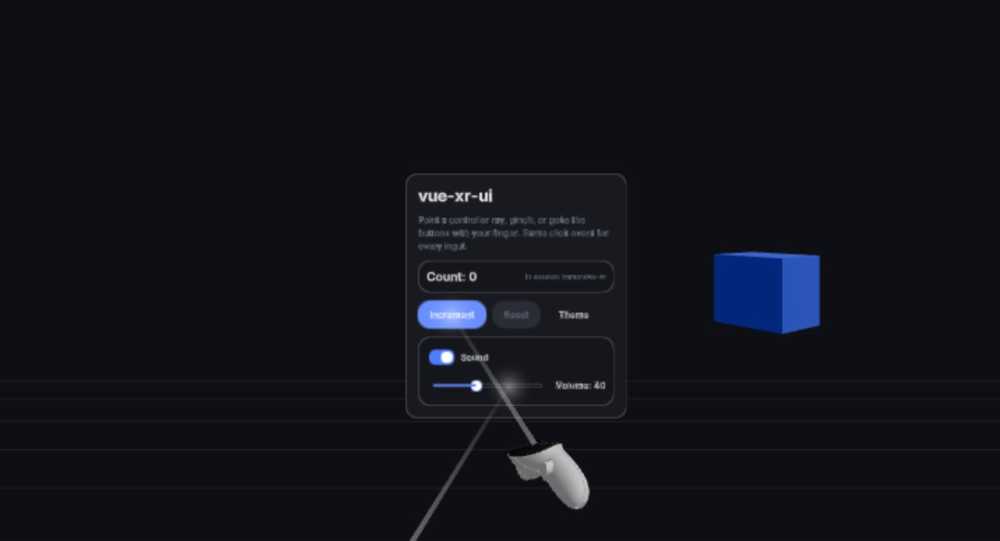
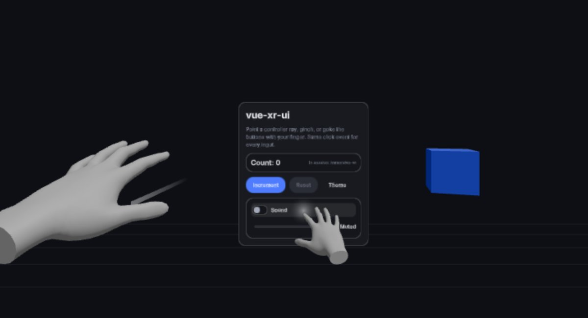
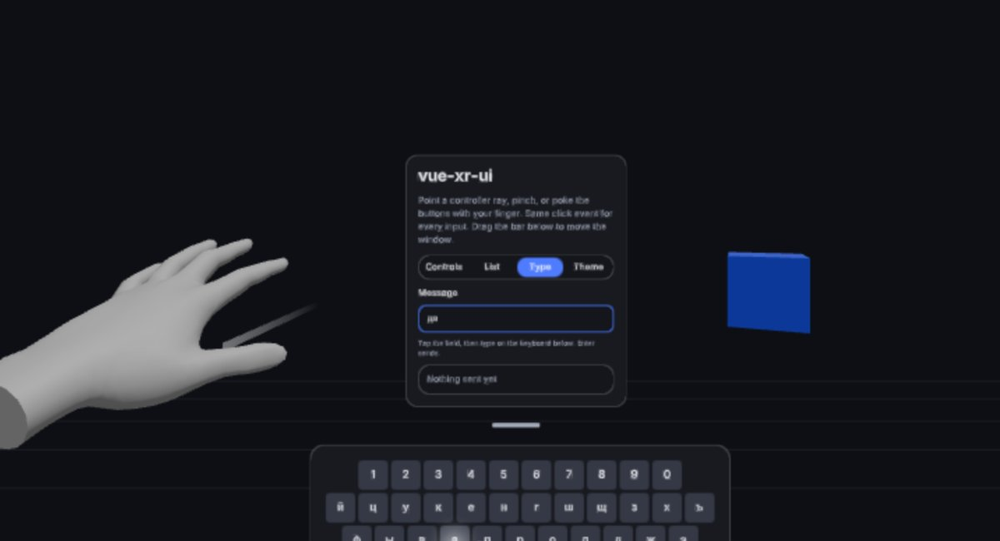
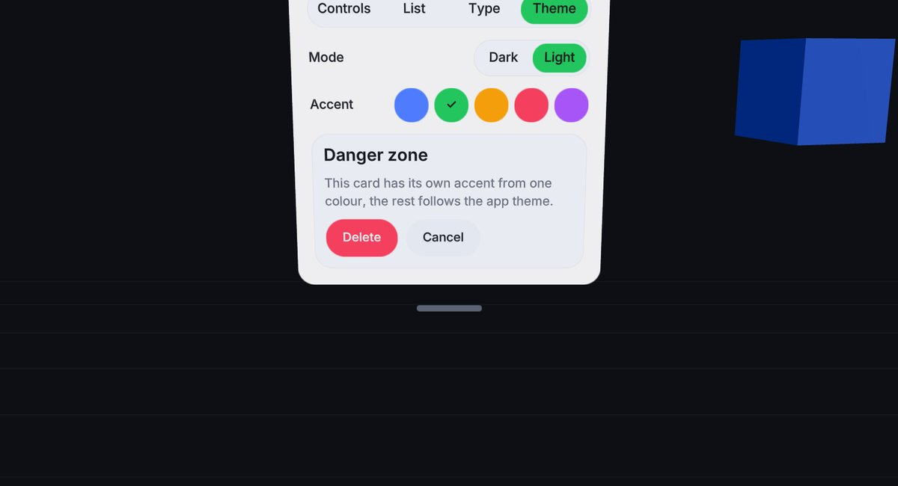

<div align="center">

# vue-xr-ui

**Vue components for VR and mixed-reality interfaces on the web.**

Write spatial UI the way you write a Vue app: components, props, events,
design tokens. Runs in the Meta Quest 3 browser, in PC VR and on a regular
screen with a mouse.

[](https://www.npmjs.com/package/vue-xr-ui)
[](https://www.npmjs.com/package/vue-xr-ui)
[](https://www.npmjs.com/package/vue-xr-ui)
[](https://bundlephobia.com/package/vue-xr-ui)
[](https://github.com/ovchinnikov-lxs/vue-xr-vr/actions/workflows/ci.yml)
[](https://codecov.io/gh/ovchinnikov-lxs/vue-xr-vr)
[](LICENSE)

[**Docs**](https://vue-xr-ui.vercel.app) · [**Playground**](https://vue-xr-vr.vercel.app) (open it in the Quest browser) · [npm](https://www.npmjs.com/package/vue-xr-ui) · [Changelog](packages/vue-xr-ui/CHANGELOG.md) · [Roadmap](https://github.com/ovchinnikov-lxs/vue-xr-vr/milestones)

</div>

<table>
  <tr>
    <td></td>
    <td></td>
  </tr>
  <tr>
    <td></td>
    <td></td>
  </tr>
</table>

```vue
<XrPanel :position="[0, 1.45, -1]" :width="440">
  <XrText variant="headline">Hello, XR</XrText>
  <XrButton @click="count++">Clicked {{ count }} times</XrButton>
</XrPanel>
```

## Features

- **One `click` for every input**: mouse, controller ray, hand pinch, and a
  fingertip poke. A press counts on release, however long it is held.
- **Real layout and text**: flexbox (yoga) and crisp MSDF text from
  `@pmndrs/uikit`; a whole panel is a few draw calls.
- **Comfortable by default**: sizes in dmm, so text reads the same at any
  distance; targets big enough to poke.
- **Controls you need in a headset**: windows you grab and move, lists you
  scroll with a finger, an on-screen keyboard with 6 languages and voice input.
- **Themes**: dark and light, an accent from one colour, a theme per subtree.
- **Tested like a user**: 33 end-to-end tests drive every control with the
  mouse, controller rays and hands in an emulated Quest 3 on every push.
- **TypeScript**, tree-shakeable ES modules, Vue 3.5+, three.js, TresJS 5.

## Install

```bash
pnpm add vue-xr-ui @tresjs/core three
# or: npm i vue-xr-ui @tresjs/core three
```

```ts
// main.ts
import { createApp } from 'vue'
import { createXrUi, darkTheme } from 'vue-xr-ui'
import App from './App.vue'

createApp(App).use(createXrUi({ theme: darkTheme })).mount('#app')
```

```ts
// vite.config.ts: TresJS elements are custom elements to Vue
import vue from '@vitejs/plugin-vue'
import { templateCompilerOptions } from '@tresjs/core'

export default { plugins: [vue({ ...templateCompilerOptions })] }
```

```vue
<!-- App.vue -->
<script setup lang="ts">
import { ref } from 'vue'
import { TresCanvas } from '@tresjs/core'
import { XrButton, XrEnterButton, XrPanel, XrScene, XrText } from 'vue-xr-ui'

const count = ref(0)
</script>

<template>
  <TresCanvas window-size>
    <TresPerspectiveCamera :position="[0, 1.5, 0.1]" :look-at="[0, 1.4, -1]" />
    <XrScene>
      <XrPanel :position="[0, 1.45, -1]" :width="440">
        <XrText variant="headline">Hello, XR</XrText>
        <XrButton @click="count++">Clicked {{ count }} times</XrButton>
      </XrPanel>
    </XrScene>
  </TresCanvas>
  <XrEnterButton mode="vr" />
</template>
```

Full guide: [Getting started](https://vue-xr-ui.vercel.app/guide/getting-started).

## Components

| Component | Purpose |
| --- | --- |
| `<XrScene>` | Put inside `<TresCanvas>`. Owns the XR session, input and frame loop. |
| `<XrPanel>` | Floating surface, flex container with theme background. |
| `<XrWindow>` | A panel with a handle bar: grab it with a ray, a pinch or the mouse to move it; it turns to face you. `v-model:position`. |
| `<XrBox>` | Transparent flex container (the `<div>`). |
| `<XrText>` | Text in the theme's type scale. |
| `<XrButton>` | `primary` / `secondary` / `ghost`, `sm` / `md` / `lg`, `disabled`. |
| `<XrToggle>` | On/off switch with a label, `v-model`. |
| `<XrSlider>` | Number in a range, `v-model`, `min` / `max` / `step`. Drag with a ray or slide a fingertip along it. |
| `<XrTabs>` | Segmented tabs, `v-model`. Switches a value; show the content with `v-if`. |
| `<XrList>` / `<XrListItem>` | Scrolling list (drag with a ray or finger, mouse wheel); items have label, description, `selected`. A drag never selects. |
| `<XrTooltip>` | Hint shown while a ray, fingertip or mouse hovers what it wraps. |
| `<XrTextField>` | Single-line text input, `v-model`, `placeholder`, `type="password"`. Real caret: tap where to type. Physical keyboard works on desktop. Enter emits `submit`. |
| `<XrKeyboard>` | On-screen keyboard. `layouts`: built-in `en` `ru` `uk` `de` `fr` `es` and/or your own (`{ label, name, locale, rows }`), `v-model:layout`, `digits`, `symbols` (?123 page), `spaceLabel`, `keySize`, `enterLabel`, `voice`. Shift (double tap for caps lock), held Backspace repeats. Types into the last focused `<XrTextField>`, or edits its own `v-model`. |
| `<XrThemeProvider>` | A theme for everything inside it: `theme` and/or `accent`. |
| `<XrEnterButton>` | DOM button to enter/exit VR or AR. |

Every control takes the same input: mouse, controller ray, hand pinch ray and
a fingertip poke. A press counts on release however long it is held, and a
control keeps the pointer until release (like DOM pointer capture).

Composables: `useXr()` (session state, `enterVR`, `enterAR`, `exit`),
`useXrFrame(cb)` (per-frame callback that also runs inside the headset),
`useXrTheme()` (read or switch the theme).

Themes: `darkTheme`, `lightTheme`, `defineTheme(base, overrides)`, and
`withAccent(theme, '#22c55e')`, which derives hover, pressed, text-on-accent
(by contrast) and focus colours from one hex value.

Voice input: `<XrKeyboard>` has a microphone key that dictates in the active
layout's language. By default it uses the browser's Web Speech API and hides
the key where there is none; `:voice="recordingRecognizer(transcribe)"` records
the microphone and sends the audio to your own speech to text (a Whisper
endpoint, a cloud service) instead, and `:voice="false"` turns it off.

Text renders in Inter with Latin (incl. French, German, Spanish letters) and Cyrillic (Russian, Ukrainian) (uikit's bundled fonts are
Latin only). Each weight loads on first use, about 250 KB.

Composables: `useXr()` (session state, `enterVR`, `enterAR`, `exit`),
`useXrFrame(cb)` (per-frame callback that also runs inside the headset),
`useXrTheme()` (read or switch the theme). Themes: `darkTheme`, `lightTheme`,
`defineTheme`, `withAccent`. Every component has a page with a live demo and
its API in the [docs](https://vue-xr-ui.vercel.app/components/).

## Devices

| Where | Status |
| --- | --- |
| Meta Quest 3 / 3S browser, VR and passthrough | Main target, tested by hand |
| PC VR (Chrome / Edge + SteamVR or Quest Link) | Works through WebXR |
| Desktop browser, mouse | Works, no headset needed |
| Emulated Quest 3 (IWER) on localhost | Injected automatically, used in CI |

WebXR needs HTTPS outside `localhost`.

## Packages

| Package | |
| --- | --- |
| [`vue-xr-ui`](packages/vue-xr-ui) | [](https://www.npmjs.com/package/vue-xr-ui) Components and composables. |
| [`@vue-xr-ui/tokens`](packages/tokens) | [](https://www.npmjs.com/package/@vue-xr-ui/tokens) Framework-agnostic design tokens and themes. |
| [`playground`](apps/playground) | Demo app and e2e target, deployed to https://vue-xr-vr.vercel.app. |
| [`docs`](apps/docs) | Documentation site (VitePress), deployed to https://vue-xr-ui.vercel.app. |

## Development

```bash
pnpm install
pnpm dev                       # playground on http://localhost:5173, with the Quest 3 emulator
pnpm --filter docs dev         # docs site
pnpm test                      # unit tests (Vitest); pnpm test:coverage for coverage
pnpm test:e2e                  # end-to-end in an emulated Quest 3 (Playwright)
pnpm typecheck && pnpm build
```

Try local changes on a Quest: `pnpm --filter playground dev:https`, then open
`https://<your-computer-ip>:5173` in the Quest browser and accept the
certificate warning.

Coverage: unit tests cover tokens and pure logic; components are covered by
the end-to-end suite in the emulated headset. CI uploads both to Codecov
(flags `unit` and `e2e`) and the badge shows them combined. Locally:
`E2E_COVERAGE=1 pnpm test:e2e` writes `coverage-e2e/lcov.info`.

## Architecture in one picture

```
Vue app (DOM)                     <XrEnterButton>, useXr()
  └─ createXrUi() plugin          app-wide XR controller + theme
      └─ <TresCanvas>             TresJS: Vue renderer for three.js
          └─ <XrScene>            @pmndrs/xr store, XR-safe frame loop
              └─ <XrPanel>        @pmndrs/uikit root: yoga flexbox, MSDF text
                  ├─ <XrText>
                  └─ <XrButton>
```

- **Layout** is [`@pmndrs/uikit`](https://github.com/pmndrs/uikit):
  yoga flexbox, MSDF text, instanced panels (a whole UI is a few draw calls).
- **Input** is [`@pmndrs/xr`](https://github.com/pmndrs/xr) and its pointer
  events: rays, grab, touch (poke), all as DOM-like pointer events.
- **Rendering** is [TresJS](https://tresjs.org) and three.js.
- **Units** are dmm (1 mm seen from 1 m). A panel at 2 m is scaled 2x so
  it reads the same. Tokens are in dmm, so `fontSize: 18` means 18 dmm.

## Roadmap

0.1 Foundation → 0.2 Components → 0.3 Docs site → 0.4 Mixed reality →
0.5 Demo app → 1.0 Release. The plan lives in
[`.github/roadmap.yml`](.github/roadmap.yml) and on the
[milestones](https://github.com/ovchinnikov-lxs/vue-xr-vr/milestones) and the [project board](https://github.com/users/ovchinnikov-lxs/projects/4).

## Contributing

Issues and pull requests are welcome: see [CONTRIBUTING.md](CONTRIBUTING.md).
Releases follow semver with [changesets](https://github.com/changesets/changesets);
see the [CHANGELOG](packages/vue-xr-ui/CHANGELOG.md).

## License

[MIT](LICENSE)
